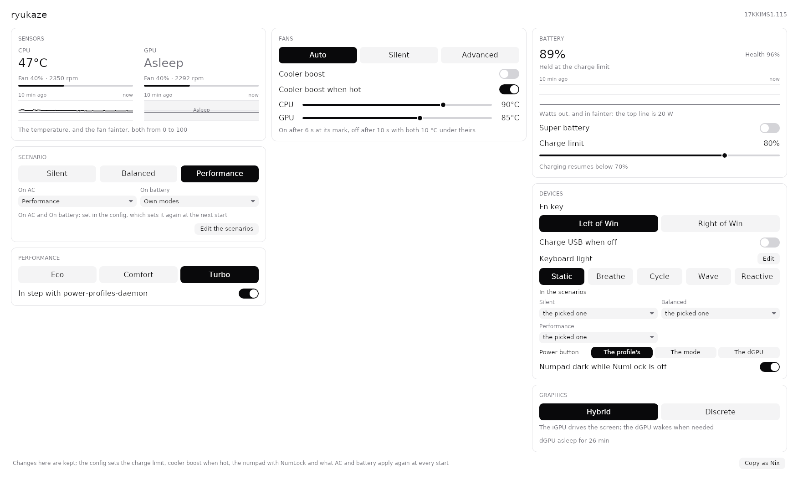
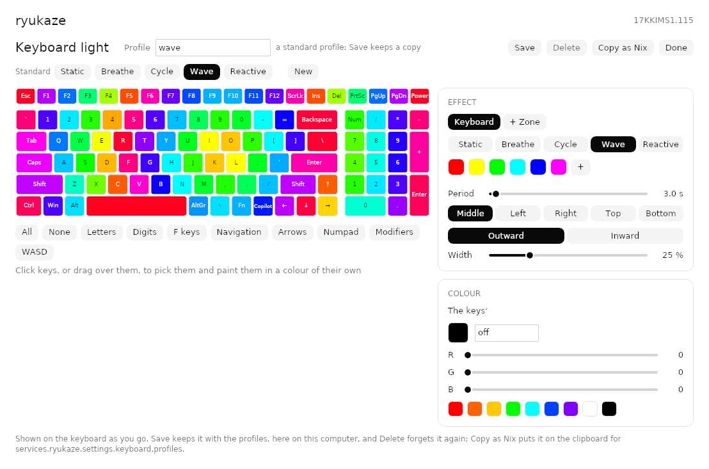

# ryukaze

[](https://github.com/kontonkara/ryukaze/actions/workflows/check.yml)

竜風, "dragon wind": control for MSI laptops on Linux, an alternative to
[MControlCenter](https://github.com/dmitry-s93/MControlCenter) written
from scratch in Rust.

<picture>
  <source media="(prefers-color-scheme: dark)" srcset="docs/images/window-dark.png">
  
</picture>

`ryukazed` is a small root daemon and the only process that touches the
embedded controller. It works through the upstream
[msi-ec](https://github.com/BeardOverflow/msi-ec) driver and serves a
narrow D-Bus API on the system bus. `ryukaze` is a window onto it, a tray
icon and a few commands.

- The EC's modes (shift mode, fan mode, super battery, cooler boost),
  with a profile each for AC and battery, MSI Center's scenarios on
  Fn+F7, and power-profiles-daemon kept in step.
- Fan curves for the advanced mode, followed adaptively or stepped
  through by the EC, and cooler boost by itself when hot.
- The charge limit, the camera, the Fn key's side, USB power while the
  laptop is off, and the GPU MUX.
- The keyboard's backlight: profiles of the controller's own effects,
  keys and zones of their own, on Fn+F9.
- A window with the temperatures, fans and battery and their last ten
  minutes, a tray icon, a card on screen when the modes change, and
  `ryukaze --status` for a terminal.

Tested on an MSI Alpha 17 C7VG; what goes beyond msi-ec, ryukaze does only
on firmware checked (see the [hardware notes](docs/hardware.md)).

The keyboard light's editor, shown on the keyboard as it goes:

<picture>
  <source media="(prefers-color-scheme: dark)" srcset="docs/images/lights-dark.png">
  
</picture>

And the card on screen when the modes change, as on Fn+F7:

<picture>
  <source media="(prefers-color-scheme: dark)" srcset="docs/images/osd-dark.png">
  
</picture>

## On NixOS

```nix
{
  inputs.ryukaze.url = "github:kontonkara/ryukaze";

  # in the system configuration:
  imports = [ inputs.ryukaze.nixosModules.default ];
  services.ryukaze = {
    enable = true;
    users = [ "alice" ]; # may change the EC; everyone may read it
    tray.enable = true; # the icon in graphical sessions
    osd.enable = true; # a card on screen when the modes change
    settings = {
      charge_limit = 80;
      profiles.ac.scenario = "performance";
      profiles.battery.scenario = "silent";
    };
  };
}
```

The module doesn't install msi-ec: the driver has to be there and know
your EC firmware.

## On other distributions

ryukaze needs systemd, the [msi-ec](https://github.com/BeardOverflow/msi-ec)
driver for your EC firmware (often packaged for DKMS), and to build, Rust
with cargo, a recent stable. In the tree:

```sh
make
sudo make install USERS="$USER"
sudo systemctl daemon-reload
sudo systemctl reload dbus
sudo systemctl enable --now ryukazed
systemctl --user enable --now ryukaze ryukaze-osd
```

That's in /usr/local; `PREFIX=/usr` and `DESTDIR` are for packages, and
`sudo make uninstall` takes it out again. `USERS` may change the EC, as
everyone may read it. `ec_sys` loads with write support from the next
boot, for the tachometers and the advanced fan mode (`sudo modprobe ec_sys`
loads it now; where it's built into the kernel, it takes
`ec_sys.write_support=1` on the kernel's command line).

The window keeps what's changed in it, and `/etc/ryukaze/config.toml`
(see the [config](docs/config.md)) is for what's to be set at every
start. The tray icon and the card start with sessions that have
`graphical-session.target`, as GNOME's and KDE's do; elsewhere, start
`ryukaze --hidden` and `ryukaze --osd` at login.

## Documentation

- [Using ryukaze](docs/usage.md): the window, the tray, the commands, the
  Fn keys, the colours
- [Config](docs/config.md): `/etc/ryukaze/config.toml`, every key
- [The advanced fan mode](docs/fans.md)
- [The keyboard's backlight](docs/keyboard.md): effects, keys, zones
- [D-Bus API](docs/dbus.md)
- [Hardware notes](docs/hardware.md): what's tested, the EC's RAM, the GPU
  MUX, the keyboard's controller
- [Development](docs/development.md): running from the tree, the tests
